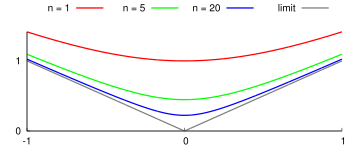

Topics:
- Abbott §6.3: Differentiation of function sequences
- Abbott §6.4: Series of functions
- Abbott §6.5: Power series and radius of convergence

---

Topics:
- Abbott §6.3: Uniform convergence and differentiation
- Abbott §6.4: Series of functions

Formalization: [`FunctionSequences.v`](docs/rocq/RUG.Analysis.FunctionSequences.html), [`Series.v`](docs/rocq/RUG.Analysis.Series.html)
---

## Cauchy criterion

**Theorem:** the following statements are equivalent:

1. $f_n$ converges uniformly on $A$
2. for all $\epsilon>0$ there exists $N_\epsilon\in\mathbb{N}$ s.t.
$$
n, m \geq N_\epsilon
\quad\Rightarrow\quad
|f_n(x)-f_m(x)| < \epsilon
\qquad\forall\,x\in A
$$
---

## A counter example

**Exercise:** $f_n(x) = \sqrt{x^2 + 1/n} \to |x|$ uniformly on $[-1,1]$

Every $f_n$ is differentiable at $x=0$, but the limit is **NOT**!
---

## Preservation of differentiability

**Lemma:** assume that

1. $f_n : [a,b] \to \mathbb{R}$ differentiable for all $n$
2. $f_n'$ converges uniformly on $[a,b]$ *(note the prime!)*
3. $f_n(x_0)$ converges for some $x_0\in [a,b]$

Then $f_n$ converges uniformly on $[a,b]$
---

## Preservation of differentiability

**Proof:** for each $\epsilon>0$ there exists $N_1, N_2\in\mathbb{N}$ such that
$$\begin{aligned}
n,m \geq N_1
 & \;\;\Rightarrow\;\;
|f_n'(x)-f_m'(x)| < \frac{\epsilon}{2(b-a)}\qquad\forall\,x\in [a,b]  \\[5mm]
n,m \geq N_2
 & \;\;\Rightarrow\;\; \big|f_n(x_0)-f_m(x_0)\big| < \frac{\epsilon}{2}
\end{aligned}$$

**Claim:**
$$
n,m \geq \max\{N_1,N_2\}
\quad\Rightarrow\quad
|f_n(x) - f_m(x)| < \epsilon \qquad\forall\,x\in [a,b]
$$
---

## Preservation of differentiability

**Proof of claim:** apply MVT to $g = f_n - f_m$:

$$\begin{aligned}
g(x)
& = g(x) - g(x_0) + g(x_0) \\[3mm]
& = g'(c)(x-x_0) + g(x_0) \qquad\text{$c$ between $x$ and $x_0$} \\[6mm]
|g(x)| & \leq |g'(c)|\cdot|x-x_0| + |g(x_0)| \\[3mm]
& \leq |g'(c)|\cdot(b-a) + |g(x_0)| \\[6mm]
|f_n(x) - f_m(x)| & \leq |f_n'(c)-f_m'(c)|\cdot(b-a) + |f_n(x_0) - f_m(x_0)|
\end{aligned}$$
---

## Preservation of differentiability

**Theorem:** assume that

1. $f_n : [a,b] \to \mathbb{R}$ differentiable for all $n$
2. $f_n'\to g$ uniformly on $[a,b]$
3. $f_n(x_0)$ converges for some $x_0\in [a,b]$

Then there exists a differentiable $f : [a,b]\to\mathbb{R}$ such that
$$
f_n \to f \quad\text{uniformly} \qquad\text{and}\qquad f'=g
$$

**Moral:** $(\lim f_n)' = \lim (f_n')$ *— limit and derivative can be swapped*
---

## Preservation of differentiability

**Proof:** Lemma $\;\Rightarrow\; f_n\to f$ uniformly on $[a,b]$ for some $f$

Let $c \in [a,b]$ and $\epsilon>0$ be arbitrary

To prove: there exists $\delta>0$ such that
$$
0 < |x-c|<\delta
\quad\Rightarrow\quad
\left|\frac{f(x)-f(c)}{x-c}-g(c)\right| < \epsilon
$$
---

## Preservation of differentiability

**Proof (ctd):** show there exists $n\in\mathbb{N}$ and $\delta>0$ s.t.
$$\begin{aligned}
\left|\frac{f(x)-f(c)}{x-c}-\frac{f_n(x)-f_n(c)}{x-c}\right| & \leq \epsilon / 3 \\[5mm]
\left|\frac{f_n(x)-f_n(c)}{x-c}-f_n'(c)\right| & < \epsilon / 3 \quad\text{for}\quad 0 < |x-c| < \delta \\[5mm]
\left|f_n'(c)-g(c)\right| & < \epsilon / 3 \\[5mm]
\Longrightarrow\quad\left|\frac{f(x)-f(c)}{x-c}-g(c)\right| & < \epsilon \qquad \text{by triangle inequality}
\end{aligned}$$
---

## Preservation of differentiability

**Proof (ctd):** MVT $\;\Rightarrow\;$ there exists $\alpha$ between $x$ and $c$ s.t.
$$
\left|\frac{(f_m(x)-f_n(x)) - (f_m(c)-f_n(c))}{x-c}\right| = |f_m'(\alpha) - f_n'(\alpha)|
$$

There exists $N_1\in\mathbb{N}$ s.t.
$$
n,m \geq N_1 \;\;\Rightarrow\;\; |f_m'(x) - f_n'(x)| < \frac{\epsilon}{3}\qquad\forall\,x \in [a,b]
$$

Order Limit Theorem with $m\to\infty$ gives
$$
n \geq N_1 \;\;\Rightarrow\;\;
\left|\frac{f(x)-f(c)}{x-c} - \frac{f_n(x)-f_n(c)}{x-c}\right| \leq \frac{\epsilon}{3}
$$
---

## Preservation of differentiability

**Proof (ctd):** there exists $N_2\in\mathbb{N}$ s.t.
$$
n \geq N_2 \quad\Rightarrow\quad |f_n'(c)-g(c)| < \frac{\epsilon}{3}
$$

Now fix $n = \max\{N_1,N_2\}$ and pick $\delta>0$ s.t.
$$
0 < |x-c| < \delta
\quad\Rightarrow\quad
\left|\frac{f_n(x)-f_n(c)}{x-c}-f_n'(c)\right| < \frac{\epsilon}{3}
$$
---

# Series of functions

## Series of functions

**Definition:** let $f_n : A \to \mathbb{R}$ and $s_n = f_1 + \dots + f_n$, then

$$\begin{aligned}
\sum_{n=1}^\infty f_n \to f \text{ pointwise} & \quad\text{means}\quad s_n \to f \text{ pointwise} \\[5mm]
\sum_{n=1}^\infty f_n \to f \text{ uniformly} & \quad\text{means}\quad s_n \to f \text{ uniformly}
\end{aligned}$$
---

## Cauchy criterion

**Theorem:** the following statements are equivalent

1. $\sum_{n=1}^\infty f_n$ converges uniformly on $A$
2. for all $\epsilon>0$ there exists $N\in\mathbb{N}$ s.t.
$$
n > m \geq N \quad\Rightarrow\quad |f_{m+1}(x) + \dots + f_n(x)| < \epsilon \quad\text{for all } x\in A
$$

**Proof:** follows from
$$
|s_m(x) - s_n(x)| = |f_{m+1}(x) + \dots + f_n(x)|
$$
---

## The Weierstrass test

**Theorem:** assume that

1. $|f_n(x)| \leq C_n$ for all $x\in A$
2. $\sum_{n=1}^\infty C_n$ converges

Then $\sum_{n=1}^\infty f_n$ converges uniformly on $A$

**Proof:** for all $x \in A$ we have
$$
|s_n(x) - s_m(x)| = |f_{m+1}(x) + \dots + f_n(x)| \leq C_{m+1} + \dots + C_n
$$

Cauchy criterion for $\sum_{n=1}^\infty C_n \;\Rightarrow\;$ Cauchy criterion for $s_n$
---

## Preservation of continuity

**Theorem:** assume

1. $\sum_{n=1}^\infty f_n \to f$ uniformly on $A$
2. $f_n$ is continuous on $A$ for all $n$

Then $f$ is continuous on $A$

**Proof:**

$s_n=f_1+\dots+f_n$ is continuous on $A$ for all $n\in\mathbb{N}$

$s_n\to f$ uniformly $\;\Rightarrow\; f$ is continuous on $A$
---

## Preservation of differentiability

**Theorem:** assume

1. $f_n : [a,b] \to \mathbb{R}$ is differentiable for all $n$
2. $\sum_{n=1}^\infty f_n' \to g$ uniformly on $[a,b]$
3. $\sum_{n=1}^\infty f_n(x_0)$ converges for some $x_0\in[a,b]$

Then there exists a differentiable $f : [a,b]\to\mathbb{R}$ s.t.
$$
\sum_{n=1}^\infty f_n \to f \quad\text{uniformly}
\qquad\text{and}\qquad
f' = \sum_{n=1}^\infty f_n'
$$

*Term-wise Differentiability Theorem*
---

# Pointwise convergence

## Power series

General form of a PS:

$$
\sum_{n=0}^\infty a_n x^n = a_0 + a_1 x + a_2 x^2 + a_3 x^3 + \cdots
$$

Convergence?

Continuity / differentiability of the limit?
---

## Pointwise convergence

**Theorem:**
$$
\sum_{n=0}^\infty a_n x^n \text{ converges at } c\neq 0
\;\;\Rightarrow\;\;
\sum_{n=0}^\infty \big|a_n x^n\big| \text{ converges for } |x| < |c|
$$

**Proof:**
$$\begin{aligned}
\sum_{n=0}^\infty a_n c^n \;\text{ converges}
& \Rightarrow  \lim a_n c^n = 0 \\[2mm]
& \Rightarrow  \big(a_n c^n\big) \text{ is bounded} \\[4mm]
& \Rightarrow  \exists\,M>0 \quad\text{s.t.}\quad \big|a_n c^n\big| \leq M \quad\forall\,n\in\mathbb{N}
\end{aligned}$$
---

## Pointwise convergence

**Proof (ctd):**
$$
\big|a_n x^n\big|
=
\left|a_n\left(c\cdot\frac{x}{c}\right)^n\right|
=
\big|a_n c^n\big| \cdot \left|\frac{x}{c}\right|^n
\leq
M\cdot \left|\frac{x}{c}\right|^n \qquad \forall\,n\in\mathbb{N}
$$

Note: $|x| < |c| \;\Rightarrow\; \left|\displaystyle\frac{x}{c}\right|<1$

Apply comparison test:
$$
\sum_{n=0}^\infty M\left|\frac{x}{c}\right|^n \text{ converges}
\quad\Rightarrow\quad
\sum_{n=0}^\infty \big|a_n x^n\big| \text{ converges}
$$
---

## Radius of convergence

**Corollary:** there exists $R \geq 0$ such that

- $|x| < R \;\;\Rightarrow\;\;$ PS converges at $x$
- $|x| > R \;\;\Rightarrow\;\;$ PS diverges at $x$

$R$ is called the **radius of convergence**
---

## Radius of convergence

Methods for **computing** $R$ from the $a_n$'s

**Root test:** if $L = \lim \sqrt[n]{|a_n|}$ exists, then $R = 1/L$

**Ratio test:** if $L = \lim \left|\displaystyle\frac{a_{n+1}}{a_n}\right|$ exists, then $R = 1/L$

*[interpret $L = 0$ as $R = \infty$]*
---

## Root test

**Example:** $\displaystyle\sum_{n=0}^\infty \frac{x^n}{5^{n^2}}$

Radius of convergence:
$$\begin{aligned}
a_n = \frac{1}{5^{n^2}}
& \quad\Rightarrow\quad \sqrt[n]{|a_n|} = \frac{1}{5^n} \\[4mm]
& \quad\Rightarrow\quad L = 0 \\[4mm]
& \quad\Rightarrow\quad R = \infty
\end{aligned}$$
---

## Ratio test

**Example:** $\displaystyle\sum_{n=1}^\infty \frac{x^n}{n^2}$

Radius of convergence:
$$\begin{aligned}
a_n = \frac{1}{n^2}
& \quad\Rightarrow\quad \frac{a_{n+1}}{a_n} = \frac{n^2}{(n+1)^2} \\[4mm]
& \quad\Rightarrow\quad L = 1 \\[4mm]
& \quad\Rightarrow\quad R = 1
\end{aligned}$$
---

## Beware of the boundary points!

| Example | Radius | at $x=-R$ | at $x=R$ |
|---|---|---|---|
| $\displaystyle\sum_{n=1}^\infty x^n$ | $R=1$ | **divergent** | **divergent** |
| $\displaystyle\sum_{n=1}^\infty \frac{1}{n}x^n$ | $R=1$ | convergent | **divergent** |
| $\displaystyle\sum_{n=1}^\infty \frac{(-1)^n}{n}x^n$ | $R=1$ | **divergent** | convergent |
| $\displaystyle\sum_{n=1}^\infty \frac{1}{n^2}x^n$ | $R=1$ | convergent | convergent |
