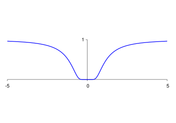

Topics:
- Abbott §6.5: Uniform convergence and differentiation of power series
- Abbott §6.6: Taylor series and Lagrange remainder

Formalization: [`PowerSeries.v`](docs/rocq/RUG.Analysis.PowerSeries.html), [`Taylor.v`](docs/rocq/RUG.Analysis.Taylor.html)

---

# Uniform convergence

## Uniform convergence

**Theorem:**
$$
\sum_{n=0}^\infty |a_n c^n| \text{ convergent}
\;\;\Rightarrow\;\;
\sum_{n=0}^\infty a_n x^n \text{ uniformly conv.~on } [-|c|,|c|]
$$

**Proof:** for $|x| \leq |c|$ we have
$$
|a_n x^n| = |a_n|\cdot |x|^n \leq |a_n|\cdot |c|^n = |a_n c^n| =: M_n
$$

Apply Weierstrass' test:
$$
\sum_{n=0}^\infty M_n \quad\text{conv.}
\quad\Rightarrow\quad
\sum_{n=0}^\infty a_n x^n \quad\text{unif.~conv.~on } [-|c|,|c|]
$$
---

## Recall: preservation of continuity

**Theorem:** assume

1. $\sum_{n=1}^\infty f_n \to f$ uniformly on $A$
2. $f_n$ is continuous on $A$ for all $n$

Then $f$ is continuous on $A$
---

## Continuity of the limit

**Corollary:** $\displaystyle\sum_{n=0}^\infty a_n x^n$ is a continuous function on $(-R,R)$

**Proof:** take $x_0 \in (-R,R)$ and $|x_0| < c < d < R$, then
$$\begin{aligned}
\text{PS convergent at } d
& \Rightarrow  \text{PS absolutely convergent at } c \\[3mm]
& \Rightarrow  \text{PS uniformly convergent on } [-c,c]\\[3mm]
& \Rightarrow  \text{PS continuous on } [-c,c] \\[1mm]
&              \quad\textit{[each term $a_n x^n$ is continuous!]}\\[3mm]
& \Rightarrow  \text{PS continuous at } x_0
\end{aligned}$$
---

## Continuity of the limit

**Corollary:**
$$
\sum_{n=0}^\infty |a_n R^n| \text{ convergent}
\;\;\Rightarrow\;\;
\sum_{n=0}^\infty a_n x^n \text{ uniformly conv.~on } [-R,R]
$$
In particular, the PS is continuous on $[-R,R]$

What if convergence is **conditional** at $x=R$ or $x=-R$?
---

# Term-wise differentiation

## Differentiation does not change $R$!

**Theorem:**
$$
\sum_{n=0}^\infty a_n x^n \text{ conv.~on } (-R,R)
\;\;\Rightarrow\;\;
\sum_{n=0}^\infty na_n x^{n-1} \text{ conv.~on } (-R,R)
$$

**Proof:** if $|c|<1$, then there exists $M > 0$ s.t.
$$
|nc^{n-1}| \leq M \quad\forall\,n\in\mathbb{N}
$$

Let $|x| < t < R$, then
$$
|na_n x^{n-1}|
=
\frac{1}{t}\left(n\left|\frac{x}{t}\right|^{n-1}\right)|a_n t^n|
\leq
\frac{M}{t} |a_n t^n|
$$

Apply comparison test
---

## Recall: preservation of differentiability

**Theorem:** assume

1. $f_n : [a,b] \to \mathbb{R}$ is differentiable for all $n$
2. $\sum_{n=1}^\infty f_n' \to g$ uniformly on $[a,b]$
3. $\sum_{n=1}^\infty f_n(x_0)$ converges for some $x_0\in[a,b]$

Then there exists a differentiable $f : [a,b]\to\mathbb{R}$ s.t.
$$
\sum_{n=1}^\infty f_n \to f \quad\text{uniformly}
\qquad\text{and}\qquad
f' = \sum_{n=1}^\infty f_n'
$$

*[Term-wise Differentiability Theorem]*
---

## Differentiation can be done term-by-term!

**Theorem:** for any PS with radius $R$ we have
$$
\bigg(\sum_{n=0}^\infty a_n x^n\bigg)' = \sum_{n=1}^\infty na_n x^{n-1} \qquad \forall\,x \in (-R,R)
$$

**Proof:** let $0 \leq c < R$, then

- $\sum_{n=0}^\infty na_n x^{n-1} \text{ converges uniformly on } [-c,c]$
- $\sum_{n=0}^\infty a_n x^n \text{ converges at } x = 0$

Now apply Term-wise Differentiability Theorem

*[Note: we can apply the theorem any number of times!]*
---

## Differentiation

**Example:** for all $x \in (-1,1)$ we have
$$\begin{aligned}
\sum_{n=1}^\infty \frac{(-1)^{n+1}}{n}x^n & \to f(x) \tag{$*$} \\[3mm]
\sum_{n=1}^\infty (-1)^{n+1}x^{n-1}       & \to \frac{1}{1+x} = f'(x) \;\;\Rightarrow\;\; f(x) = \log|1+x| + C
\end{aligned}$$

Note that:

- $C = f(0) = 0$ so $f(x) = \log|1+x|$
- Abel's Theorem $\;\Rightarrow\;$ PS in ($*$) converges uniformly on $[0,1]$
- Hence, PS in ($*$) is continuous at $x=1$
---

## Differentiation

**Example (ctd):**
$$
\sum_{n=1}^\infty \frac{(-1)^{n+1}}{n}
=
\lim_{x \to 1} \sum_{n=1}^\infty \frac{(-1)^{n+1}}{n}x^n
=
\lim_{x \to 1} f(x)
=
f(1)
=
\log 2
$$

Conclusion:
$$
\log 2 = 1 - \frac{1}{2} + \frac{1}{3} - \frac{1}{4} + \cdots
$$
---

## From power series to Taylor series

| | | | | |
|---|---|---|---|---|
| $f(x)$ | $=$ | $a_0 + a_1 x + a_2 x^2 + a_3 x^3 + \cdots$ | $\Rightarrow$ | $f(0) = a_0$ |
| $f'(x)$ | $=$ | $a_1 + 2a_2 x + 3a_3 x^2 + \cdots$ | $\Rightarrow$ | $f'(0) = a_1$ |
| $f''(x)$ | $=$ | $2a_2 + 6a_3 x + \cdots$ | $\Rightarrow$ | $f''(0) = 2a_2$ |
| $f'''(x)$ | $=$ | $6a_3 + \cdots$ | $\Rightarrow$ | $f'''(0) = 6a_3$ |

Taylor's formula: $\displaystyle \quad a_n = \frac{f^{(n)}(0)}{n!}$
---

## Taylor series

Assume $f$ is inf. often differentiable on interval around $x=0$

**Definition:** the Taylor series of $f$ around $x=0$ is given by
$$
\sum_{n=0}^\infty \frac{f^{(n)}(0)}{n!} x^n
$$

**Question:** does the series converge to $f$?
---

# Lagrange remainder

## Lagrange remainder

**Definition:**
$$\begin{aligned}
s_n(x) & = \sum_{k=0}^n \frac{f^{(k)}(0)}{k!}x^k \hspace{28mm}\text{(partial sum)} \\[4mm]
E_n(x) & = f(x) - s_n(x) \hspace{30mm}\text{(remainder)}
\end{aligned}$$

**Theorem:** for $n \in \mathbb{N}$ and $x > 0$ there exists $c \in (0,x)$ such that
$$
E_n(x) = \frac{f^{(n+1)}(c)}{(n+1)!} x^{n+1}
$$

**Note:** $c$ depends on both $n$ and $x$!

*If $x<0$, then $c \in (x,0)$*
---

## Lagrange remainder

**Lemma:** assume that

- $x>0$ and $h(t)$ is $n+1$ times differentiable on $[0,x]$
- $h(x)=0$ and $h^{(k)}(0) = 0$ for all $k = 0,\dots,n$

Then $h^{(n+1)}(c) = 0$ for some $c \in (0,x)$

**Proof:** repeated application of Rolle's theorem gives
$$\begin{aligned}
h(0) = h(x) & \Rightarrow h'(c_1) = 0 \text{ for some } c_1 \in (0,x) \\
h'(0) = h'(c_1) & \Rightarrow h''(c_2) = 0 \text{ for some } c_2 \in (0,c_1) \\
& \vdots \\
h^{(n)}(0) = h^{(n)}(c_n) & \Rightarrow h^{(n+1)}(c_{n+1}) = 0 \text{ for some } c_{n+1} \in (0,c_n)
\end{aligned}$$
---

## Lagrange remainder

**Theorem:** for $n \in \mathbb{N}$ and $x > 0$ there exists $c \in (0,x)$ such that
$$
E_n(x) = \frac{f^{(n+1)}(c)}{(n+1)!} x^{n+1}
$$

**Proof:** fix $x>0$ and consider
$$
h(t) = f(t) - s_n(t) - \left(\frac{f(x) - s_n(x)}{x^{n+1}}\right)t^{n+1}
$$

Note that:
$$
h(x) = 0
\quad\text{and}\quad
h^{(k)}(0) = 0, \quad k = 0,\dots,n
$$

*If $x<0$, then $c \in (x,0)$*
---

## Lagrange remainder

**Proof (ctd):** the lemma gives $c \in (0,x)$ such that
$$
f^{(n+1)}(c) - \underbrace{s_n^{(n+1)}(c)}_{= \, 0} - (n+1)! \left(\frac{f(x) - s_n(x)}{x^{n+1}}\right) = 0
$$

Rearranging gives
$$
f(x) - s_n(x) = \frac{f^{(n+1)}(c)}{(n+1)!} x^{n+1}
$$
---

## Taylor series around different points

Assume $f$ is inf. often differentiable on interval around $a$

**Definition:** the Taylor series of $f$ around $x=a$ is given by
$$
\sum_{n=0}^\infty \frac{f^{(n)}(a)}{n!} (x-a)^n
$$

**Lagrange remainder:** for $x>a$ there exists $c \in (a,x)$ such that
$$
E_n(x) = f(x) - s_n(x) = \frac{f^{(n+1)}(c)}{(n+1)!}(x-a)^{n+1}
$$

*If $x<a$, then $c \in (x,a)$*
---

# Examples

## Taylor series for $f(x) = e^x$

| $n$ | $f^{(n)}(x)$ | $a_n = f^{(n)}(0) / n!$ |
|---|---|---|
| $0$ | $e^x$ | $1$ |
| $1$ | $e^x$ | $1$ |
| $2$ | $e^x$ | $1/2!$ |
| $3$ | $e^x$ | $1/3!$ |
| $4$ | $e^x$ | $1/4!$ |
| $\vdots$ | $\vdots$ | $\vdots$ |
---

## Taylor series for $f(x) = e^x$

For $x \neq 0$ there exists $c \in (-|x|,|x|)$ such that
$$
e^x = \sum_{k=0}^n \frac{1}{k!}x^k + \frac{e^c}{(n+1)!}x^{n+1}
$$

For any $a>0$ we have
$$
\sup_{x \in [-a,a]} \bigg|e^x - \sum_{k=0}^n \frac{1}{k!}x^k\bigg|\leq e^a\cdot\frac{a^{n+1}}{(n+1)!} \to 0
\quad\text{as}\quad n\to\infty
$$

The Taylor series of $f$ converges uniformly to $f$ on $[-a,a]$!
---

## Taylor series for $f(x) = e^x$

$f(x) = e^x$, $s_n(x) = \sum_{k=0}^n \dfrac{x^k}{k!}$, $n=1,2,3,4,5$
---

## Taylor series for $f(x) = \sin(x)$

| $n$ | $f^{(n)}(x)$ | $a_n = f^{(n)}(0) / n!$ |
|---|---|---|
| $0$ | $\phantom{-}\sin(x)$ | $\phantom{-}0$ |
| $1$ | $\phantom{-}\cos(x)$ | $\phantom{-}1$ |
| $2$ | $-\sin(x)$ | $\phantom{-}0$ |
| $3$ | $-\cos(x)$ | $-1/3!$ |
| $4$ | $\phantom{-}\sin(x)$ | $\phantom{-}0$ |
| $5$ | $\phantom{-}\cos(x)$ | $\phantom{-}1/5!$ |
| $\vdots$ | $\phantom{--}\vdots$ | $\phantom{-}\vdots$ |
---

## Taylor series for $f(x) = \sin(x)$

For $x \neq 0$ there exists $c \in (-|x|,|x|)$ such that
$$
|E_n(x)|
=
\left|\frac{f^{(n+1)}(c)}{(n+1)!}x^{n+1}\right|
\leq
\frac{|x|^{n+1}}{(n+1)!}
$$

Remainder converges to 0 uniformly on any interval $[-a,a]$:
$$
\sup_{x\in[-a,a]} |E_n(x)| \leq  \frac{a^{n+1}}{(n+1)!} \to 0
\quad\text{as}\quad
n\to\infty
$$

Conclusion:
$$
\sin(x) = x - \frac{1}{3!}x^3 + \frac{1}{5!}x^5 - \frac{1}{7!}x^7 + \cdots \qquad\forall\,x\in\mathbb{R}
$$
---

## Taylor series for $f(x) = \sin(x)$

$f(x) = \sin(x)$, $s_{2m+1}(x) = \sum_{k=0}^m \dfrac{(-1)^k x^{2k+1}}{(2k+1)!}$, $m=0,1,2,3$
---

## Taylor series for $f(x) = \cos(x)$

$f(x) = \cos(x)$, with successive Taylor approximations around $x=0$
---

## Taylor series for $f(x) = \ln(1+x)$

$$
f(x) = \ln(1+x)
\quad\Rightarrow\quad
f^{(n)}(x) = \frac{(-1)^{n+1} (n-1)!}{(1+x)^n} \qquad \forall\, n \in \mathbb{N}
$$

For $x>0$ there exists $c \in (0,x)$ such that
$$
\ln(1+x) = \sum_{k=1}^n \frac{(-1)^{k+1}}{k}x^k + \frac{(-1)^n}{(n+1)(1+c)^{n+1}}\,x^{n+1}
$$

**Exercise:** prove that

1. the Taylor series converges uniformly to $f$ on $[0,1]$
2. $\ln(2) = 1 - \tfrac{1}{2} + \tfrac{1}{3} - \tfrac{1}{4} + \cdots$
---

## Taylor series for $f(x) = \ln(1+x)$

$f(x) = \ln(1+x)$, $s_n(x) = \sum_{k=1}^n \dfrac{(-1)^{k+1}x^k}{k}$, $n=1,2,3,4,5$
---

## Taylor series for $f(x)=\arctan(x)$

On $[-1,1]$ we have
$$
\arctan(x) = x - \frac{1}{3} x^3 + \frac{1}{5}x^5 - \frac{1}{7}x^7 + \cdots
$$

The convergence is uniform on $[-1,1]$

For $x=1$ we get
$$
\frac{\pi}{4} = 1 - \frac{1}{3} + \frac{1}{5} - \frac{1}{7} + \cdots
$$
---

## A counter example

$$
f(x) = \begin{cases} e^{-1/x^2} & \text{if } x \neq 0 \\ 0 & \text{if } x = 0 \end{cases}
\qquad\Rightarrow\qquad
f^{(n)}(0)=0 \quad\forall\,n\in\mathbb{N}
$$

The Taylor series of $f$ does **NOT** converge to $f$!
---

# Applications

## Approximating square roots

2nd order approximation of $\sqrt{5} = 2.236...$

$$\begin{aligned}
\sqrt{x} & = 1 + \tfrac{1}{2}(x-1) - \tfrac{1}{8}(x-1)^2 + E_3(x) \\[2mm]
\sqrt{5} & \approx 1 + \tfrac{4}{2} - \tfrac{16}{8} \;\; = \;\; 1 \\[6mm]
\sqrt{x} & = 2 + \tfrac{1}{4}(x-4) - \tfrac{1}{64}(x-4)^2 + \widetilde{E}_3(x) \\[2mm]
\sqrt{5} & \approx 2 + \tfrac{1}{4} - \tfrac{1}{64} \;\; = \;\; 2.234375
\end{aligned}$$

Truncated Taylor series around $x=4$ much more accurate!
